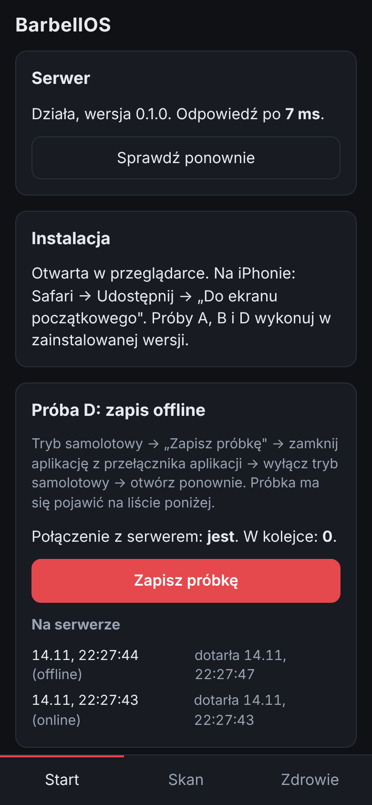
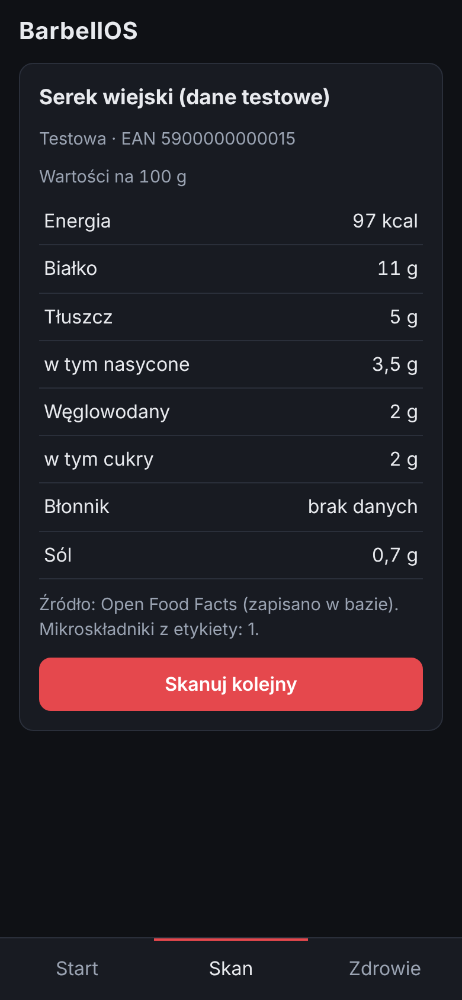

# BarbellOS

Dieta, trening siłowy i regeneracja w jednej aplikacji na iPhone'a. Projekt prywatny, budowany pod jeden cel: 600 kg w trójboju na Akademickich Mistrzostwach Polski 2027.

**Stan: etap 0.** Działa szkielet i cztery próby techniczne, od których zależy reszta. Dziennik posiłków, tracker treningu i podsumowania AI powstają w kolejnych etapach.

<p>
  
  
</p>

## Jak to działa

```
iPhone                                   Serwer
┌───────────────────────────┐   JSON    ┌──────────────────────────────┐
│ PWA (React + TypeScript)  │◄─────────►│ FastAPI (Python)             │
│ skan kodów, zdjęcia,      │           │  core/  obliczenia + testy   │
│ kolejka zapisów offline   │           │  ai/    router Gemini/Claude │
└───────────────────────────┘           │  off/   Open Food Facts      │
┌───────────────────────────┐   POST    │  Postgres                    │
│ Skróty: Apple Health      │──────────►│                              │
│ (opaska, waga)            │           └──────────────────────────────┘
└───────────────────────────┘
```

- **Liczby liczy kod, model językowy tylko je komentuje.** Kalorie, e1RM, trend wagi i wskaźnik regeneracji to funkcje w `backend/app/core/` z testami.
- **Serwer jest źródłem prawdy,** telefon trzyma kopię podręczną i trwałą kolejkę zapisów na czas bez zasięgu.
- **Każda wartość odżywcza ma źródło:** etykieta, tabele składu albo szacunek.

Pełna specyfikacja: [docs/DOKUMENTACJA.md](docs/DOKUMENTACJA.md). Uzasadnienie wyboru technologii: [docs/decisions/0001-stack.md](docs/decisions/0001-stack.md).

## Uruchomienie lokalne (Windows 11, PowerShell)

Wymagania: Python 3.12 lub nowszy (testowane na 3.13), Node.js 22, Docker Desktop (opcjonalnie).

```powershell
# 1. Konfiguracja
Copy-Item .env.example .env

# 2. Baza. Bez Dockera: ustaw w .env  DATABASE_URL=sqlite:///./barbellos.db  i pomiń ten krok
docker compose up -d db

# 3. Backend
cd backend
py -m venv .venv
.\.venv\Scripts\Activate.ps1
pip install -e ".[dev]"
alembic upgrade head
python -m app.tools.seed
uvicorn app.main:app --reload
```

W drugim terminalu:

```powershell
cd web
npm install
npm run dev
```

Aplikacja: http://localhost:5173. Dokumentacja API: http://localhost:8000/api/docs.

Lokalnie logowanie jest pomijane, dopóki `APP_PASSWORD_HASH` w `.env` jest puste. Na telefonie aplikacja wymaga HTTPS; jak ją wystawić, opisuje [docs/etap-0.md](docs/etap-0.md).

## Testy

```powershell
cd backend ; pytest -q ; ruff check . ; ruff format --check .
cd ..\web  ; npm run typecheck ; npm test ; npm run build
```

Obliczenia treningowe są porównywane z wartościami policzonymi oryginalnym planem (601 pozycji, `backend/tests/fixtures/training_reference.json`).

## Struktura

| Katalog | Zawartość |
|---|---|
| `backend/app/core/` | Czysta logika: trening, wartości odżywcze, bilans energii, regeneracja |
| `backend/app/api/` | Endpointy FastAPI |
| `backend/app/ai/` | Interfejs dostawców modeli i router zadań |
| `backend/app/off/` | Klient Open Food Facts |
| `backend/app/db/` | Modele, migracje Alembic |
| `web/src/features/` | Ekrany |
| `web/src/lib/` | API, kolejka offline, skaner kodów |
| `seed/` | Dane startowe |
| `shortcuts/` | Budowa skrótu wysyłającego dane z Apple Health |
| `docs/` | Dokumentacja, decyzje, instrukcje prób |

## Plan

| Etap | Zakres |
|---|---|
| **0** | Próby ryzyka: skan w PWA, Apple Health przez Skróty, pokrycie Open Food Facts, zapis offline |
| 1 | Dziennik diety bez AI |
| 2 | AI w diecie: zdjęcie etykiety, zdjęcie posiłku, opis tekstowy |
| 3 | Regeneracja: import z Apple Health, trend wagi, wskaźnik regeneracji |
| 4 | Trening: przeniesienie planu i dziennika |
| 5 | Coach: podsumowanie dnia i tygodnia |
| 6 | Mikroskładniki |

## Praca z agentami

Kod powstaje z pomocą agentów (Claude Code, Antigravity). Zasady, których muszą przestrzegać, są w [AGENTS.md](AGENTS.md).

## Dane i źródła

- Produkty: [Open Food Facts](https://world.openfoodfacts.org) (licencja ODbL).
- Mikroskładniki produktów podstawowych (etap 6): USDA FoodData Central (CC0).
- Wartości odniesienia: rozporządzenie UE 1169/2011.

Aplikacja nie jest wyrobem medycznym i nie zastępuje lekarza, dietetyka ani trenera.
